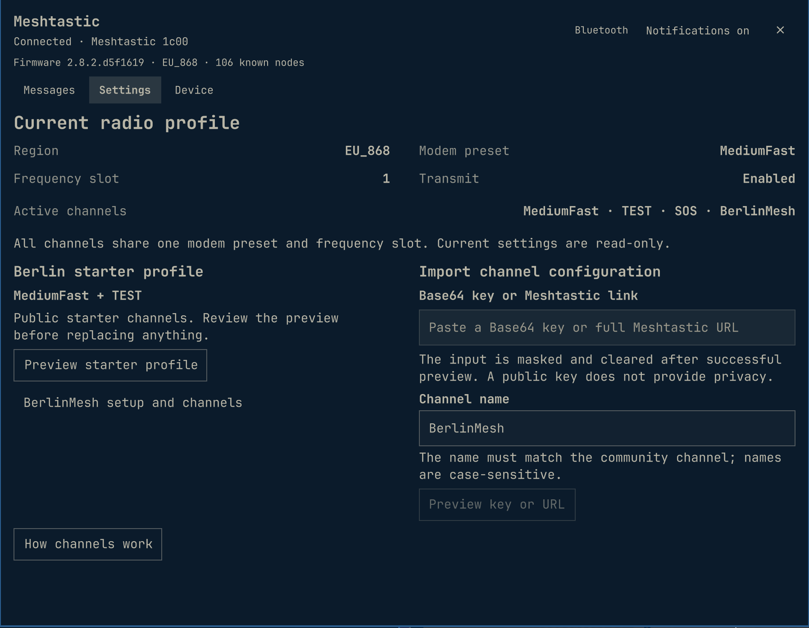

# Meshtastic for Omarchy

A native Omarchy bar messenger for Meshtastic radios over USB or Bluetooth:
channel conversations, local history, unread counts, desktop notifications and
explicit radio-configuration previews. One Python bridge shares the connection
between panels on multiple monitors. Plugin ID: `miszarchy.meshtastic`.



## Requirements

- Omarchy with its native Quickshell plugin API (`qs.Commons`, `qs.Ui` and
  `Commons.Translations`); a generic Qt/QML installation is not sufficient.
- `uv`, Python 3.13, systemd user services and `notify-send` (Arch: `libnotify`).
- The pinned official Python SDK, `meshtastic==2.7.11`, installed by explicit
  setup into `${XDG_DATA_HOME:-$HOME/.local/share}/omarchy-meshtastic/venv`.
- A compatible Meshtastic radio and antenna. USB needs permission to access its
  serial device; Bluetooth needs BlueZ, an adapter, and system-level pairing
  using the PIN displayed by the radio.

The plugin does not install OS packages, flash firmware, grant device permissions
or require root. Dependencies are external software with their own licenses.
The pinned Meshtastic SDK is GPL-3.0-only:
[source at 2.7.11](https://github.com/meshtastic/python/tree/19d066970e652a5a72a18718149b638e3473a6eb),
[SDK license](https://github.com/meshtastic/python/blob/19d066970e652a5a72a18718149b638e3473a6eb/LICENSE.md).

## Install

Install from the public upstream repository:

```sh
omarchy plugin add https://github.com/misza-one/meshtastic_omarchy_plugin
cd "${XDG_CONFIG_HOME:-$HOME/.config}/omarchy/plugins/miszarchy.meshtastic"
./bin/install
```

Native add validates the **root** manifest and discovers `plugin/BarWidget.qml`.
It does not install Python dependencies or the bridge service. If prompted,
leave the plugin disabled until setup finishes. Setup installs dependencies,
enables and restarts the owned `omarchy-meshtastic.service`, but does not edit
your environment file, message history or bar layout. Enable the widget explicitly
if it is not already placed:

```sh
omarchy plugin enable miszarchy.meshtastic --section centerBegin
omarchy-shell shell summon miszarchy.meshtastic
```

For a development checkout, run `./bin/install` there instead. It links the
installed plugin to the checkout root; do not move the checkout afterward.
An old link to this same checkout's `plugin/` is migrated to the root. Its
original virtual environment is preserved as `legacy-project-venv` beside the
managed runtime, and the generated `plugin/.venv` symlink is removed.
Unrelated environments, links or customized service units are refused rather
than overwritten. Keep development environments outside the checkout:
Omarchy rejects any symlink inside a plugin folder, including Python venvs.

### Select transport

Create or edit `${XDG_CONFIG_HOME:-$HOME/.config}/omarchy/meshtastic.env` yourself.
USB is the default. For a generic USB adapter that cannot be identified reliably:

```ini
MESHTASTIC_TRANSPORT=usb
MESHTASTIC_PORT=/dev/serial/by-id/your-radio
```

For Bluetooth, pair in BlueZ first, then set `MESHTASTIC_TRANSPORT=ble` and
`MESHTASTIC_BLE_ADDRESS` to your radio's Bluetooth address. Restart the bridge
after changes:

```sh
systemctl --user restart omarchy-meshtastic.service
```

Bluetooth failure does not silently fall back to USB. USB may remain connected
for power. The same radio retains its history when changing transport.
Keep custom XDG paths consistent with the systemd user manager: the service uses
systemd's `%E` configuration-directory expansion.

## Update and remove

For a native git installation, use `omarchy plugin update miszarchy.meshtastic`,
then run the installed `./bin/install` again to refresh dependencies and the
service. For development, update your checkout and rerun `./bin/install`.
Neither operation resets environment, history or widget placement.

Before removing plugin files, run from the installed root or linked checkout:

```sh
./bin/uninstall
omarchy plugin remove miszarchy.meshtastic
```

The first command verifies ownership, disables/stops the bridge, removes its
unit and reloads the user manager. Customized/unrelated units are refused.
The native command removes the installation (or only unlinks a development
checkout) and handles the widget. Environment and local history are retained.
The managed runtime and any preserved legacy environment remain beside local
data when the plugin is removed; a development checkout also remains. Stop the
service before deleting a native clone. No cleanup command deletes your
environment file or history.

## Use and radio limits

Click the icon to open/close; select a channel in the left column. Send with the
button or Ctrl+Enter, close with Escape, and switch tabs with Ctrl+Tab or
Ctrl+Shift+Tab. Drafts are per channel. Settings previews configuration changes;
Device shows transport, firmware, radio state and passively observed nodes.
Missing telemetry is unknown, not zero. A remembered node is not proof of range.

Messages are limited to **228 UTF-8 bytes**, not characters. Failed sends are not
automatically retried. An ACK is not a read receipt; missing ACK does not prove
that nobody received a broadcast. No delivery, coverage or emergency-service
guarantee is provided. Follow local region, frequency, power and duty-cycle rules.
Stop the bridge before opening the same radio with another CLI or flasher.

### Channels and Berlin

Matching channel names alone are insufficient: radios need compatible LoRa
settings, channel name, key and encryption mode. All channels on one radio share
its radio preset/frequency. Selecting a conversation does not switch presets.

The Berlin starter profile uses EU_868 / MEDIUM_FAST, public **MediumFast** and
**TEST** channels. Send tests on TEST, never SOS. Obtain the current BerlinMesh
coordination key/link from the community. A publicly known PSK is not private.

Paste a Base64 key or Meshtastic sharing link into Settings, inspect the preview,
then separately approve changes. A key-only import updates the matching named
channel or adds a secondary channel without replacing the others. **A full link
or starter profile replaces the whole channel set** and may change LoRa settings
and reboot/disconnect the radio. Verify the reread state afterward and do not
interrupt power during writes. The starter does not enable MQTT or change node
role, position or telemetry. The importer is not a general firmware editor:
custom modulation, forced frequencies and duty-cycle override are rejected.
No profiles are downloaded or applied in the background.

Sources: [BerlinMesh configuration](https://codeberg.org/berlinmesh/meshtastic),
[Berlin Chaos Mesh](https://potatomesh.net/pages/about),
[Meshtastic channels](https://meshtastic.org/docs/configuration/radio/channels/).

## Privacy

History begins when the bridge receives messages; the radio does not supply old
conversations through a normal configuration read. The UI shows the latest 200
messages per channel. Local data is stored under
`${XDG_DATA_HOME:-$HOME/.local/share}/omarchy-meshtastic/`, including
`history.sqlite3`, **in plaintext**, not an encrypted vault. Keep backups and disk
access permissions appropriate. Channel-key changes separate conversation history.
Private messages are not mixed into channel conversations.

The plugin adds no telemetry or background web-profile fetching. Radio/MQTT
behavior still depends on your device configuration. Notifications can expose
sender/message text on screen; use the notification toggle when needed.
Channel keys and imported links are not written to history or logs, but the
environment file and local records remain sensitive. This plugin does not
promise radio anonymity, confidentiality or end-to-end security. Plugins run
unsandboxed inside Omarchy; marketplace listing is not a security audit.

## Languages and contributions

English, Polish and German catalogs are shipped in `plugin/i18n/`. Language
follows Omarchy's live language selection; notification action labels resolve
the selected language at delivery. Other languages fall back through
locale → base language → English → key. Protocol identifiers, device/channel
names, units and CLI/log diagnostics are not translated.

To contribute a translation, copy the English catalog to an Omarchy language-code
JSON file beside it, retain every key and `%1`-style placeholder, and translate
whole messages. Plural entries need the language's CLDR categories and `other`;
do not concatenate translated fragments. Test live switching, plurals and fallback.

```sh
./bin/python -m unittest discover -s tests -p 'test_i18n.py' -v
```

This validates complete keys, placeholders, plural forms and notification
localization. Isolated native live-language QML coverage runs when
Omarchy/Quickshell is available; otherwise that native case is explicitly skipped.

## Diagnostics and development checks

```sh
systemctl --user status omarchy-meshtastic.service
journalctl --user -u omarchy-meshtastic.service -n 40 --no-pager
./bin/test
```

`bin/test` uses the managed runtime for isolated Python tests and translation
catalog checks. Native manifest validation and QML checks require Omarchy and
Quickshell. CI runs the portable Python/catalog checks on Python 3.13 and
explicitly skips native-only integration cases. Tests do not access real radios.

## License

SPDX-License-Identifier: **GPL-3.0-only**. Copyright (c) 2026 miszarchy.
See the complete [GNU GPL version 3](LICENSE). Version 1.0.0.
Marketplace listing and verification are maintained separately from this source
repository.
